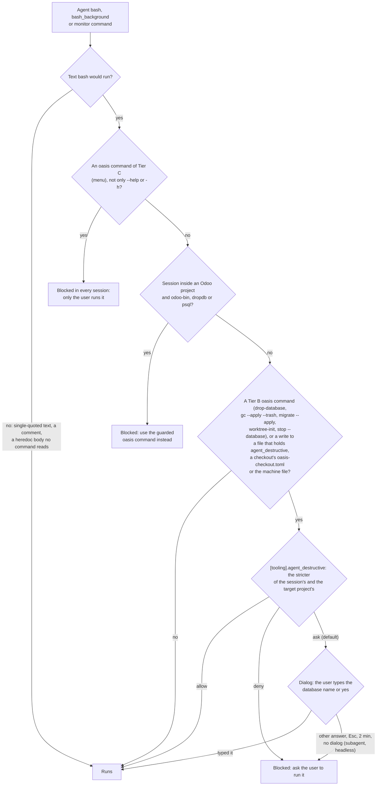

# Bash guard

The Gentle Shell layer checks every bash command the agent runs before it runs, and every call of
Pi's `edit` and `write` tools on the files that hold `[tooling].agent_destructive`, on a checkout's
`oasis-checkout.toml` and on the machine file. Each command falls in one of three tiers, taken from
the core [policy table](agent-contract.md): it runs (Tier A, allow), the user confirms it first
(Tier B, ask), or only the user can run it (Tier C, deny).

## Guarded tools

Every tool that runs its `command` input as shell text is checked the same way, so the same
command gets the same decision (the same deny reason, the same dialog and `agent_destructive`, or
it runs) whichever tool runs it:

- `bash` (Pi);
- `bash_background` and `monitor` (Gentle Shell's background jobs).

Calls nested in another tool, such as `tools.bash(...)` or `tools.bash_background(...)` in a
`codemode` script, go through Pi's `tool_call` event under the nested tool's name, so they are
checked like the agent's own calls. A call whose `command` is not a string, and every other tool
(`job_stop`, `job_list`, ...), is left alone. Commands the user types (`!` in the editor) are not
agent tool calls and are not checked. In the rest of this page, a bash command is any of them.



## Tiers

<!-- Generated by `python3 -B tools/policy.py --guard`; tests/test_policy.py checks it. -->
| Tier | Agent bash command | What happens |
| --- | --- | --- |
| A (allow) | `setup`, `setup --apply`, `bootstrap`, `create-database`, `init-dev-database`, `start`, `restart`, `stop`, `status`, `install-module`, `update-module`, `test-module`, `verify-module`, `lint-module`, `odoo-shell`, `list-databases`, `module-status`, `model-info`, `module-info`, `view-info`, `xmlid-info`, `audit-dependencies`, `doctor`, `check-environment`, `gc`, `gc --apply`, `gc --trash`, `trash`, `migrate`, `migrate --plan`, `worktree-init --dry-run` | Runs |
| B (ask) | `stop --database`, `gc --apply --trash`, `drop-database`, `migrate --apply`, `worktree-init` | Runs after the user confirms it in a dialog (see [The dialog](#the-dialog)), unless `[tooling].agent_destructive` says `deny` or `allow`; so do changes to the setting files (see [The setting files](#the-setting-files)), which `allow` never skips |
| C (deny) | `menu`, `odoo-bin`, `dropdb`, `psql` | Blocked; only the user runs it (`odoo-bin`, `dropdb` and `psql` only in Odoo projects) |

An oasis command's operation is the table row whose words all appear in its arguments, the most
specific one (`gc --apply --trash` over `gc --apply`, `worktree-init --dry-run` over
`worktree-init`; the stricter on a tie, so `migrate --plan --apply` asks). An argument that is not
literal (`$ARGS`, a glob, a substitution) may expand to anything, so the command's strictest row
applies: `oasis migrate --plan $EXTRA` asks, `oasis setup $ARGS` runs. Any command's `--help` or
`-h` alone runs.

The ask commands are recognized through `oasis` and `odoo19` (also as `python3 -B <path>/oasis`,
behind `sudo`, `env`, `timeout` and the other wrappers, inside `bash -c`, `eval` or `$(...)`) and
through oasis's own tool scripts (`tools/drop-database`, `tools/stop`, `tools/gc`, ...), recognized
like the menu's scripts (see [Action menu](action-menu.md)): the installed bundle's from anywhere, an
oasis checkout's when the path resolves to it. `tools/stop` or `tools/gc` of another project is not
oasis's and runs. `worktree-init`'s scripts (`tools/worktree-init`, `worktree_init.py`) count in any
directory, and `migrate`'s (`tools/migrate`, `tools/migrate.py`) in any `tools` directory. When one command holds a denied program and an ask command, the deny tier
decides first, exactly as before. The entry points' `--project` is also recognized as argparse
takes it: `--project=<dir>` and its unambiguous prefixes (`--proj <dir>`, `--p=<dir>`), so
`oasis --proj /p menu` is blocked and `oasis --proj /p drop-database <name>` asks,
like their `--project` forms. `--project` is optional: an entry point run without it works on the
git top level of the directory it runs in, and the guard judges it against that directory (see
[The setting](#the-setting)).

A command line is judged on every command it holds, not only the first denied one: `psql -l;
oasis --project /p menu` is blocked outside an Odoo project too, because `menu` is Tier C in every
session. In an Odoo project the reason names the first denied program, as before; outside one, the
first Tier C oasis command. A line whose
only denied programs are `odoo-bin`, `dropdb` or `psql` still runs outside Odoo projects.

## The dialog

In an interactive session (TUI or RPC) the layer shows, before anything runs:

```text
oasis: the agent wants to run

oasis --project /work/shop drop-database shop_dev_old --confirm shop_dev_old

Type shop_dev_old to allow drop-database shop_dev_old. Esc, another answer or no answer within 120 s refuses.
```

- `drop-database` asks for the database name, `stop --database`, `gc --apply --trash`,
  `migrate --apply`, `worktree-init` and a change to a setting file for `yes` (exactly, surrounding
  spaces aside). The command is shown as the agent wrote it, without terminal control sequences.
  The CLI itself runs `drop-database`, `gc --apply --trash`, `migrate --apply` and `worktree-init`
  only with `--confirm <exact name>` (see [Agent contract](agent-contract.md)), so the command the
  user confirms carries it.
- One bash command with several ask commands gets one dialog each, in order; the first refusal
  stops it.
- A wrong answer, Esc, no answer within 2 minutes, or aborting the agent's turn blocks the command
  and tells the agent that the user did not confirm it and to ask the user. A session without a
  dialog (a subagent, or a headless `-p`/JSON run) blocks it the same way, without asking.
- `drop-database` needs its database name written literally (`drop-database shop_dev_old`, not
  `drop-database $NAME`), so the user confirms the name that runs; otherwise it is blocked before
  any dialog.
- Every ask decision, approved or refused, is recorded in the session as an *Agent command
  approved* or *Agent command refused* entry with the command and the reason (`typed
  shop_dev_old`, `wrong answer`, `no answer`, `no dialog`, `database name not literal`,
  `agent_destructive = deny`, `agent_destructive = allow`). Pi shows these entries but never sends
  them to the model.

## The setting

`[tooling].agent_destructive` in the workspace file (see [Workspace file](workspace-file.md))
decides the ask tier for the agent:

```toml
[tooling]
agent_destructive = 'ask'    # default: the dialog; 'deny' blocks them; 'allow' runs them without a dialog
```

- The layer reads it through `tools/config.py` (`AGENT_DESTRUCTIVE=...`) at each ask command, so
  a change applies to the next command, for the session's project and for the project the command
  targets: the entry point's `--project <dir>`, or the `OASIS_PROJECT_ROOT` (else
  `ODOO19_PROJECT_ROOT`) assigned before a tool script (`OASIS_PROJECT_ROOT=<dir> <tool>`, `env
  OASIS_PROJECT_ROOT=<dir> <tool>`). The stricter of the two decides (`deny` over `ask` over
  `allow`), so `oasis --project <other> drop-database <name>` from an `allow` project still asks
  or is denied when the other project says so; a refusal by the target names it (`... = "deny" in
  the configuration of <root>`). A session outside an Odoo project, a configuration that cannot be read,
  and a target that is not literal (`--project "$DIR"`), not an Odoo project, unreadable, or set
  elsewhere on the line (`export OASIS_PROJECT_ROOT=...; <tool>`) count as `ask`.
- An entry point without `--project` targets the directory it runs in, as the command line tells
  it: the session's directory (the session's project alone decides), or the directory after a
  literal `cd <dir>` or `pushd <dir>` earlier on the line, `env -C <dir>` (`--chdir`) or `sudo -D
  <dir>` (`--chdir`). There the stricter of the session's and that directory's project decides, as
  with `--project <dir>`: `cd /work/other && oasis drop-database <name>` from an `allow` project
  is denied when `/work/other` says `deny`. A directory the text does not tell (`cd "$DIR"`, after
  `popd`, or a substitution such as `$(oasis stop --database)` on a line that changes directory)
  and a directory outside any Odoo project count as `ask`. So does every command after a change
  of directory the guard does not follow: `cd`, `pushd` or `popd` behind `builtin`, `command` or
  `time` (`builtin cd /work/other && oasis stop --database`), `eval`, `source` or `.` (whatever
  they run: `eval "$GO"`, `source ./env.sh`), and a command word that is not literal (`$CD
  /work/other`, a glob or a substitution), which may be `cd`; the session's project is never
  assumed after them. `command -v` only looks a program up and changes nothing. Nothing is
  loosened: a command that asked before still asks.
- `deny` turns the ask tier into deny; `allow` lets those commands run without a dialog (each run
  is still recorded). Neither changes the allow or deny tiers.
- Only the user sets it: `oasis-checkout.toml` refuses the key, no tool or command argument
  changes it, and an invalid value stops every command with `Invalid tooling agent_destructive:
  use ask, deny or allow.` `oasis doctor` prints `PASS agent_destructive=<value>`.

## The setting files

The files that hold `[tooling].agent_destructive` are in the ask tier too, so the agent cannot
turn the setting to `allow` by itself: any file named `oasis-workspace.toml` in the session's
directory or one of its parents (where `tools/config.py` looks for it; the real path of the
session's directory counts as well), and any `.odoo19-agent.toml` there, the per-checkout file of
earlier versions, which no command reads any more but `oasis migrate` converts into the workspace
file, setting included (see [Migrating to the workspace file](migrating.md)). In a linked worktree
with no workspace file at or above it, the workspace file its main checkout reads, found through
git, is one of them too: it holds that worktree's setting (see
[Workspace file](workspace-file.md#discovery-precedence-and-versions)).

A checkout's `oasis-checkout.toml` is in the same tier: it refuses `agent_destructive`, but it sets
the checkout's `checkout_slug`, which moves its database namespace, and its environment. It counts
at the root of a checkout, where `tools/config.py` reads it: the session's checkout, a checkout a
write reaches by its path or after a literal `cd` (`cd /work/other && sed -i ... oasis-checkout.toml`,
the checkout `--project /work/other` names), and a linked worktree outside the workspace directory,
whose main checkout's workspace file is found through git. Its dialog says `(it sets checkout_slug,
the database namespace, and the environment)`. An `oasis-checkout.toml` below a checkout's root
(`addons/x/oasis-checkout.toml`) or outside any Odoo project is never read and does not ask; a bash
write whose target the text does not tell (`> "$ROOT"/oasis-checkout.toml`) counts by its name.

The [machine file](workspace-file.md#machine-file) is in the same tier, because it holds the Odoo
source paths every project on the machine uses: `$XDG_CONFIG_HOME/oasis/config.toml` (when that
variable is absolute) and `~/.config/oasis/config.toml` in any case, from any session directory.
Its dialog says `(the machine file: it holds the Odoo source paths)`; a bash write whose target the
text does not tell counts when it ends in `oasis/config.toml`.

These edits always reach the dialog: `allow` does not cover them, so an agent cannot change its own
permission, a checkout's database namespace or the Odoo source without the user, and without a UI
they are refused. `deny` blocks them.

- Pi's `edit` and `write` tool calls on such a file, written as the agent passed it (relative to
  the session's directory, `~/...`, `@path`) or through a link that reaches it.
- Bash writes to such a file: a redirection (`>`, `>>`, `2>`, `&>`, `>|`), `tee`, `sed -i` (or
  `--in-place`), and `mv` or `cp` onto it or into its directory (`cp new oasis-workspace.toml`,
  `cp -t <dir> oasis-workspace.toml`), also behind wrappers and inside `bash -c`. A target the text
  does not tell (`> "$ROOT"/oasis-workspace.toml`, `> "$XDG_CONFIG_HOME"/oasis/config.toml`) counts
  by its file name. Reading the file
  (`cat`, `grep`, `sed -n`, `cp` from it) is not a change.

The dialog names the file:

```text
oasis: the agent wants to call

edit ../oasis-workspace.toml

Type yes to allow editing /work/shop/oasis-workspace.toml (it holds [tooling].agent_destructive). Esc, another answer or no answer within 120 s refuses.
```

A bash command shows `oasis: the agent wants to run` and the command instead, with one dialog per
file and per ask command, in the order bash reaches them. The setting decides these changes like the other ask commands
(`deny` blocks them, `allow` lets them run), a session without a dialog blocks them, and each
decision is recorded as an *Agent command approved* or *Agent command refused* entry with `edit
<path>` or `write <path>` (or the bash command) as its command. Refusals tell the agent that
nothing changed and to ask the user to make the change.

## What it blocks

A bash guard that blocks the agent's direct `odoo-bin`, `dropdb` and `psql` in Odoo projects and points to the guarded commands.

In every session it also blocks the Tier C oasis commands: `menu` (through `oasis` or `odoo19`, or its scripts `tools/menu` and `tools/actions.py` when they are oasis's, `--catalog` included; see [Action menu](action-menu.md) for how a script is recognized), which only the user runs; asking only for its help (`--help` or `-h` as the single argument) is allowed.

Contract change in v0.16.0 (S1): `setup --apply` (Tier A) runs; `worktree-init` (except a literal `--dry-run`, Tier A) and `migrate --apply` (Tier B) ask like `drop-database`, honoring `agent_destructive`; `migrate` without `--apply`, a literal `migrate --plan` and `worktree-init --dry-run` run. Before, the guard blocked `setup --apply`, `migrate` (except `--plan`) and `worktree-init` (`--dry-run` included) in every session.

## What it does not catch

It is a guard rail, not a sandbox: scripts, commands piped into a shell, `ssh`, `su -c` or `python3 -m odoo` are not caught, and neither are the project wrappers copied to `dev/scripts/` (`dev/scripts/drop-database`, `dev/scripts/stop`). Writes to a setting file by other programs (a Python or Node one-liner, `dd`, `install`, `ln`), by a target held in a variable (`> "$f"`), or moving or removing the file (`mv oasis-workspace.toml x`, `rm`) are not caught either. To bypass it, run the command yourself or disable the package.

## Text that bash would not run

Text that bash would not run is not blocked: substitutions inside single quotes, comments, and heredoc bodies that no command runs, such as `git commit -F - <<'EOF'` or `cat > file <<'EOF'`. A heredoc body is still checked when a command on its opening line runs what it reads: a shell (`bash`, `sh`, `zsh`, `dash`, `ksh`, `mksh`, `ash`, `fish`, `csh`, `tcsh`), `source`, `.`, `eval`, `ssh`, `su` or `xargs`, also behind `sudo`, `doas`, `env`, `timeout`, `setsid`, `stdbuf`, `ionice`, `docker exec` and similar wrappers, on a continued line or after a trailing pipe.

How the menu scripts `tools/menu` and `tools/actions.py` are recognized is described under [Action menu](action-menu.md).
