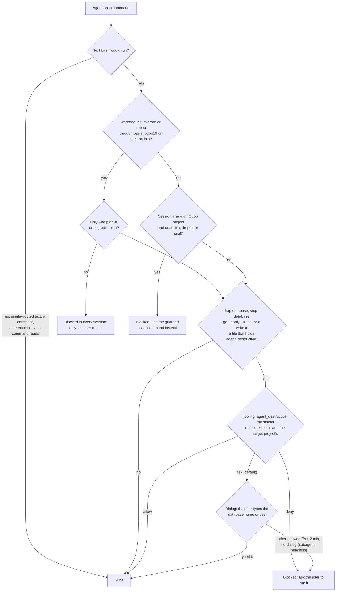

# Bash guard

The Gentle Shell layer checks every bash command the agent runs before it runs, and every call of
Pi's `edit` and `write` tools on the files that hold `[tooling].agent_destructive`. Each command
falls in one of three tiers: it runs (allow), the user confirms it first (ask), or only the user
can run it (deny).



## Tiers

| Tier | Commands | What happens |
|------|----------|--------------|
| Allow | Every other `oasis`/`odoo19` command: `test-module`, `verify-module`, `install-module`, `update-module`, `create-database`, `start`, `restart`, `stop` and `stop --force` (this checkout's server), `status`, `gc`, `gc --apply`, `gc --trash` (the list), `trash`, `trash restore`, ...; any command's `--help` or `-h` alone | Runs |
| Ask | `drop-database <name>`, `stop --database`, `gc --apply --trash`; changes to the files that hold the setting (see [The setting files](#the-setting-files)) | Runs after the user confirms it in a dialog (see [The dialog](#the-dialog)), unless `[tooling].agent_destructive` says `deny` or `allow` |
| Deny | `worktree-init`, `migrate` (except `--plan`), `menu` in every session; direct `odoo-bin`, `dropdb` and `psql` in Odoo projects | Blocked; only the user runs it |

The ask commands are recognized through `oasis` and `odoo19` (also as `python3 -B <path>/oasis`,
behind `sudo`, `env`, `timeout` and the other wrappers, inside `bash -c`, `eval` or `$(...)`) and
through oasis's own tool scripts `tools/drop-database`, `tools/stop` and `tools/gc`, recognized like
the menu's scripts (see [Action menu](action-menu.md)): the installed bundle's from anywhere, an
oasis checkout's when the path resolves to it. `tools/stop` or `tools/gc` of another project is not
oasis's and runs. When one command holds a denied program and an ask command, the deny tier
decides first, exactly as before. The entry points' `--project` is also recognized as argparse
takes it: `--project=<dir>` and its unambiguous prefixes (`--proj <dir>`, `--p=<dir>`), so
`oasis --proj /p migrate --apply` is blocked and `oasis --proj /p drop-database <name>` asks,
like their `--project` forms.

A command line is judged on every command it holds, not only the first denied one: `psql -l;
oasis --project /p migrate --apply` is blocked outside an Odoo project too, because `migrate` is
user-run in every session. In an Odoo project the reason names the first denied program, as
before; outside one, the first user-run tool (`worktree-init`, `migrate`, `menu`). A line whose
only denied programs are `odoo-bin`, `dropdb` or `psql` still runs outside Odoo projects.

## The dialog

In an interactive session (TUI or RPC) the layer shows, before anything runs:

```text
oasis: the agent wants to run

oasis --project /work/shop drop-database shop_dev_old

Type shop_dev_old to allow drop-database shop_dev_old. Esc, another answer or no answer within 120 s refuses.
```

- `drop-database` asks for the database name, `stop --database`, `gc --apply --trash` and a
  change to a setting file for `yes` (exactly, surrounding spaces aside). The command is shown as
  the agent wrote it, without terminal control sequences.
- One bash command with several ask commands gets one dialog each, in order; the first refusal
  stops it.
- A wrong answer, Esc, no answer within 2 minutes, or aborting the agent's turn blocks the command
  and tells the agent that the user did not confirm it and to ask the user. A session without a
  dialog (a subagent, or a headless `-p`/JSON run) blocks it the same way, without asking.
- `drop-database` needs its database name written literally (`drop-database shop_dev_old`, not
  `drop-database $NAME`), so the user confirms the name that runs; otherwise it is blocked before
  any dialog.
- Every ask decision, approved or refused, is recorded in the session as an *Agent command
  approved* or *Agent command refused* entry with the command and the reason (`typed
  shop_dev_old`, `wrong answer`, `no answer`, `no dialog`, `database name not literal`,
  `agent_destructive = deny`, `agent_destructive = allow`). Pi shows these entries but never sends
  them to the model.

## The setting

`[tooling].agent_destructive` in the workspace file or the legacy profile (see
[Workspace file](workspace-file.md)) decides the ask tier for the agent:

```toml
[tooling]
agent_destructive = 'ask'    # default: the dialog; 'deny' blocks them; 'allow' runs them without a dialog
```

- The layer reads it through `tools/config.py` (`AGENT_DESTRUCTIVE=...`) at each ask command, so
  a change applies to the next command, for the session's project and for the project the command
  targets: the entry point's `--project <dir>`, or the `OASIS_PROJECT_ROOT` (else
  `ODOO19_PROJECT_ROOT`) assigned before a tool script (`OASIS_PROJECT_ROOT=<dir> <tool>`, `env
  OASIS_PROJECT_ROOT=<dir> <tool>`). The stricter of the two decides (`deny` over `ask` over
  `allow`), so `oasis --project <other> drop-database <name>` from an `allow` project still asks
  or is denied when the other project says so; a refusal by the target names it (`... = "deny" in
  the configuration of <root>`). A session outside an Odoo project, a profile that cannot be read,
  and a target that is not literal (`--project "$DIR"`), not an Odoo project, unreadable, or set
  elsewhere on the line (`export OASIS_PROJECT_ROOT=...; <tool>`) count as `ask`.
- `deny` turns the ask tier into deny; `allow` lets those commands run without a dialog (each run
  is still recorded). Neither changes the allow or deny tiers.
- Only the user sets it: `oasis-checkout.toml` refuses the key, no tool or command argument
  changes it, and an invalid value stops every command with `Invalid tooling agent_destructive:
  use ask, deny or allow.` `oasis doctor` prints `PASS agent_destructive=<value>`.

## The setting files

The files that hold `[tooling].agent_destructive` are in the ask tier too, so the agent cannot
turn the setting to `allow` by itself: any file named `oasis-workspace.toml` or
`.odoo19-agent.toml` in the session's directory or one of its parents (where `tools/config.py`
looks for them; the real path of the session's directory counts as well). `oasis-checkout.toml`
refuses the key and is not one of them.

These edits always reach the dialog: `allow` does not cover them, so an agent cannot change its own
permission without the user, and without a UI they are refused. `deny` blocks them.

- Pi's `edit` and `write` tool calls on such a file, written as the agent passed it (relative to
  the session's directory, `~/...`, `@path`) or through a link that reaches it.
- Bash writes to such a file: a redirection (`>`, `>>`, `2>`, `&>`, `>|`), `tee`, `sed -i` (or
  `--in-place`), and `mv` or `cp` onto it or into its directory (`cp new oasis-workspace.toml`,
  `cp -t <dir> oasis-workspace.toml`), also behind wrappers and inside `bash -c`. A target the text
  does not tell (`> "$ROOT"/oasis-workspace.toml`) counts by its file name. Reading the file
  (`cat`, `grep`, `sed -n`, `cp` from it) is not a change.

The dialog names the file:

```text
oasis: the agent wants to call

edit ../oasis-workspace.toml

Type yes to allow editing /work/shop/oasis-workspace.toml (it holds [tooling].agent_destructive). Esc, another answer or no answer within 120 s refuses.
```

A bash command shows `oasis: the agent wants to run` and the command instead, with one dialog per
file and per ask command, in the order bash reaches them. The setting decides these changes like the other ask commands
(`deny` blocks them, `allow` lets them run), a session without a dialog blocks them, and each
decision is recorded as an *Agent command approved* or *Agent command refused* entry with `edit
<path>` or `write <path>` (or the bash command) as its command. Refusals tell the agent that
nothing changed and to ask the user to make the change.

## What it blocks

A bash guard that blocks the agent's direct `odoo-bin`, `dropdb` and `psql` in Odoo projects and points to the guarded commands.

In every session it also blocks the agent from running `worktree-init` (through `oasis` or `odoo19`, `tools/worktree-init` or `worktree_init.py`, `--dry-run` included) `migrate` (through `oasis` or `odoo19`, or `tools/migrate` and `tools/migrate.py`, the dry run included) and `menu` (through `oasis` or `odoo19`, or its scripts `tools/menu` and `tools/actions.py` when they are oasis's, `--catalog` included; see [Action menu](action-menu.md) for how a script is recognized), which only the user runs; asking only for their help (`--help` or `-h` as the single argument) is allowed, and so is the migration plan: `migrate --plan`, optionally with `--workspace <literal absolute path>` and nothing else.

`--plan` can never apply, because the tool refuses it together with `--apply`.

## What it does not catch

It is a guard rail, not a sandbox: scripts, commands piped into a shell, `ssh`, `su -c` or `python3 -m odoo` are not caught, and neither are the project wrappers copied to `dev/scripts/` (`dev/scripts/drop-database`, `dev/scripts/stop`). Writes to a setting file by other programs (a Python or Node one-liner, `dd`, `install`, `ln`), by a target held in a variable (`> "$f"`), or moving or removing the file (`mv oasis-workspace.toml x`, `rm`) are not caught either. To bypass it, run the command yourself or disable the package.

## Text that bash would not run

Text that bash would not run is not blocked: substitutions inside single quotes, comments, and heredoc bodies that no command runs, such as `git commit -F - <<'EOF'` or `cat > file <<'EOF'`. A heredoc body is still checked when a command on its opening line runs what it reads: a shell (`bash`, `sh`, `zsh`, `dash`, `ksh`, `mksh`, `ash`, `fish`, `csh`, `tcsh`), `source`, `.`, `eval`, `ssh`, `su` or `xargs`, also behind `sudo`, `doas`, `env`, `timeout`, `setsid`, `stdbuf`, `ionice`, `docker exec` and similar wrappers, on a continued line or after a trailing pipe.

How the menu scripts `tools/menu` and `tools/actions.py` are recognized is described under [Action menu](action-menu.md).
