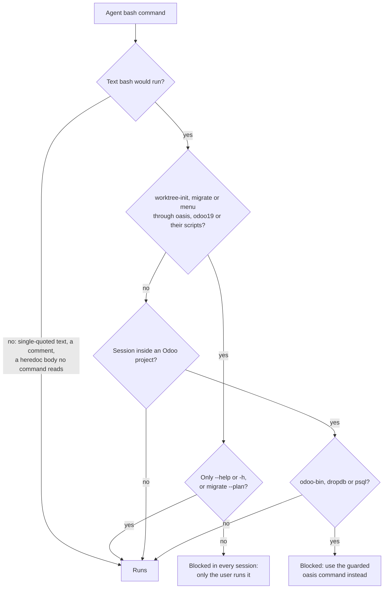

# Bash guard

The Gentle Shell layer checks every bash command the agent runs before it runs. Only the user
can run the blocked commands.

## What it blocks

A bash guard that blocks the agent's direct `odoo-bin`, `dropdb` and `psql` in Odoo projects and points to the guarded commands.

In every session it also blocks the agent from running `worktree-init` (through `oasis` or `odoo19`, `tools/worktree-init` or `worktree_init.py`, `--dry-run` included) `migrate` (through `oasis` or `odoo19`, or `tools/migrate` and `tools/migrate.py`, the dry run included) and `menu` (through `oasis` or `odoo19`, or its scripts `tools/menu` and `tools/actions.py` when they are oasis's, `--catalog` included; see [Action menu](action-menu.md) for how a script is recognized), which only the user runs; asking only for their help (`--help` or `-h` as the single argument) is allowed, and so is the migration plan: `migrate --plan`, optionally with `--workspace <literal absolute path>` and nothing else.

`--plan` can never apply, because the tool refuses it together with `--apply`.

## What it does not catch

It is a guard rail, not a sandbox: scripts, commands piped into a shell, `ssh`, `su -c` or `python3 -m odoo` are not caught. To bypass it, run the command yourself or disable the package.

## Text that bash would not run

Text that bash would not run is not blocked: substitutions inside single quotes, comments, and heredoc bodies that no command runs, such as `git commit -F - <<'EOF'` or `cat > file <<'EOF'`. A heredoc body is still checked when a command on its opening line runs what it reads: a shell (`bash`, `sh`, `zsh`, `dash`, `ksh`, `mksh`, `ash`, `fish`, `csh`, `tcsh`), `source`, `.`, `eval`, `ssh`, `su` or `xargs`, also behind `sudo`, `doas`, `env`, `timeout`, `setsid`, `stdbuf`, `ionice`, `docker exec` and similar wrappers, on a continued line or after a trailing pipe.

How the menu scripts `tools/menu` and `tools/actions.py` are recognized is described under [Action menu](action-menu.md).
