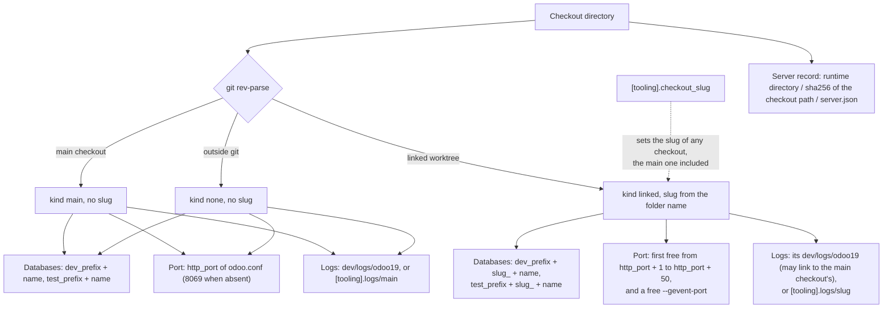

# Checkouts and worktrees

Each checkout of a project (the main checkout and every linked git worktree) gets its own
databases, server, port and logs. The PostgreSQL service is one and shared.



- [Checkout identity](#checkout-identity): kind and slug.
- [Databases per checkout](#databases-per-checkout): the namespace each checkout may use.
- [Preparing a linked worktree](#preparing-a-linked-worktree): the shared layout and `worktree-init`.
- [Servers and ports per checkout](servers-and-ports.md): one server per checkout.

## Checkout identity

Each checkout of a project gets an identity derived from the folder it runs in, so linked git worktrees (for example the ones Gentle Shell creates for sessions) can later get their own runtime resources. oasis keeps no registry: it runs a read-only `git rev-parse` in the project root and the same folder always gives the same identity.

- The main checkout has kind `main` and no slug. A project outside git has kind `none` and no slug.
- When git cannot report the checkout (not installed, a timeout after 5 s, a non-zero exit, unexpected output; git 2.31 or later is needed for `--path-format`), the reader looks for the first `.git` entry at or above the project root, as git does (ancestors in `GIT_CEILING_DIRECTORIES` are not entered). Without one, the project is outside git (kind `none`). A `.git` file (a linked worktree's gitfile) stops every command with `Cannot determine the checkout identity: git failed in a linked worktree; check git or set [tooling].checkout_slug.` (exit 2), so the worktree never loses its namespace guard; with `checkout_slug` set it continues as kind `linked` with that slug, but the main checkout is then unknown (`CHECKOUT_MAIN_ROOT` is empty): commands that start Odoo use an `odoo.conf` inside the worktree as it is and refuse a shared one (`Cannot move the addons_path of <path> to this worktree: git failed, so the main checkout is unknown.`), and compact logs cannot link into the main checkout. A `.git` directory stops every command with `Cannot determine the checkout identity: git failed (<reason>).`, whatever the profile sets.
- A linked worktree has kind `linked` and a slug from its directory name. When the name starts with the main checkout's directory name followed by `-`, `_` or `.`, that prefix is dropped. The rest is lowercased and every run of other characters than `a-z` and `0-9` becomes `_`, trimmed at both ends: `acme-shop-feature` next to `acme` gives `shop_feature`, `Feature Branch!` gives `feature_branch`.
- The slug must be 1-20 characters of `a-z`, `0-9` and `_`, starting with a letter or digit. When a name cannot produce one (empty or too long), the reader fails and asks for `[tooling].checkout_slug`.
- Optional `checkout_slug` in `[tooling]` overrides the slug for any checkout, including the main one (opt-in suffix); the reported kind stays the real one. An empty value is invalid: omit the key instead.

```toml
# Example only.
checkout_slug = 'mrp_2'
```

`/oasis` shows it as `checkout: main`, `checkout: linked worktree, slug shop_feature` or `checkout: main, slug mrp_2 (profile)`. The slug selects the checkout's database names (below); the checkout's directory selects its server and port (see [Servers and ports per checkout](servers-and-ports.md)).

## Databases per checkout

The slug goes right after the managed prefix, so each checkout has its own database namespace. A checkout without a slug (the main checkout, unless `checkout_slug` is set) keeps the previous names.

| Default | Main checkout | Checkout with slug `shop_feature` |
| --- | --- | --- |
| `install-module` target | `<dev_prefix><module>` | `<dev_prefix>shop_feature_<module>` |
| `test-module` and `verify-module` test target (disposable, new per run) | `<test_prefix><module>_r<6 hex>` | `<test_prefix>shop_feature_<module>_r<6 hex>` |
| `verify-module` update target (disposable) | `<test_prefix><module>_r<6 hex>_update` | `<test_prefix>shop_feature_<module>_r<6 hex>_update` |
| `verify-module` update target with only an explicit test database | `<test_prefix><module>_update` | `<test_prefix>shop_feature_<module>_update` |
| configured `test_database = '<test_prefix>shared'` | `<test_prefix>shared` | `<test_prefix>shop_feature_shared` (its sibling `<test_prefix>shop_feature_shared_update`) |

Every command that takes a database (`install-module` with or without `--with-demo`, `update-module`, `odoo-shell`, `start` with `-d`/`--database`, `test-module`, `verify-module`, `create-database`, `drop-database`, `module-status`, `init-dev-database`) requires a managed `<dev_prefix><name>` or `<test_prefix><name>` name; all of them except `drop-database` and `module-status` refuse names ending in the reserved disposable run suffix `_r<6 hex>` (see [Disposable test databases](disposable-test-databases.md)), and all of them refuse names ending in the reserved trash suffix `_trash_<YYYYMMDD>_<HHMMSS>` (see [Database trash](trash.md)). `drop-database` moves the database and its filestore to the trash instead of dropping it; `trash restore` brings it back and `gc --apply --trash` drops it after 7 days. In a checkout with a slug the name must also start with `<dev_prefix><slug>_` or `<test_prefix><slug>_`, so a linked worktree cannot touch the main checkout's databases or another worktree's. The rejection names the checkout and the expected prefixes, and nothing runs.

Not guarded: `start` without `-d`/`--database` uses whatever `db_name` and `--db-filter` the project's `odoo.conf` sets, so keep `db_name` out of a linked worktree's `odoo.conf` and out of an `odoo.conf` shared by several checkouts. Slugs are matched as prefixes: give each worktree a slug that is not the start of another (`wt` would also accept `wt_1`'s databases).

Database names are at most 63 bytes (PostgreSQL's identifier limit, counted in UTF-8 bytes). A test database that gets an `_update` sibling in `verify-module` is at most 56 bytes, and a configured `test_database` must fit in 56 bytes after the slug is inserted. Longer names fail before any database command; disposable names are shortened to fit instead.

`update-module [--compact] <module> <database>` and `odoo-shell` work on existing databases only: a missing database exits 2 with `Database <name> does not exist; create it with install-module or create-database.` and is never created. `install-module` and `create-database` still create their target. `update-module --compact` keeps stdout and stderr in a new run directory of the logs directory and prints `phase=update database=<name> exit=<n>`, `stdout_log=<path>` and `stderr_log=<path>`; a refusal happens before any log is written. oasis never drops a checkout's databases on its own, except the disposable test databases a run created for itself (see [Disposable test databases](disposable-test-databases.md)), the orphans `gc --apply` drops when you run it and the trash entries `gc --apply --trash` drops when you run it (see [Database trash](trash.md)).

## Preparing a linked worktree

### Shared layout

Recommended: the shared layout. Keep the checkouts in one folder and the files they share next to it, so every checkout's profile points at the same configuration:

```text
<project>/codigo/<main checkout>          main checkout
<project>/codigo/<main checkout>-<feature> linked worktrees, siblings at the same depth
<project>/config/                          odoo.conf, environment file, compose file, requirements/
<project>/data/                            Odoo data directory (data_dir in the shared odoo.conf, or [tooling].data_dir)
```

```toml
# Example only: the profile of every checkout in that layout.
config = '../../config/odoo.conf'
env_file = '../../config/.env'
compose = '../../config/compose.yml'
requirements = '../../config/requirements'
logs = '../../logs'
```

With `logs`, compact runs (`--compact`) and the browser evidence of `test-module` go to `<project>/logs/<checkout>/run-*`, where `<checkout>` is `main` for the main checkout and the slug for a linked worktree (`<project>/logs/shop_feature/`), so the checkouts need no `dev/` directory at all. Missing directories are created private (0700). `logs` resolves from the checkout like the other paths, and a run directory that resolves outside it (for example `<checkout>` as a symlink elsewhere) is refused with `Compact logs must remain inside the configured logs directory.` before anything is created. Runs written before 0.8.0 under `<logs>/odoo19/<checkout>/` are never moved or deleted, and `oasis_test_summary` still reads them. Without `logs`, runs stay under each checkout's `dev/logs/odoo19/` as before (see the end of this section).

### Addons path in a linked worktree

The shared `odoo.conf` names the main checkout in its `addons_path`. In a linked worktree (`CHECKOUT_KIND=linked`), every command that starts Odoo (`test-module`, `verify-module`, `install-module`, `update-module`, `odoo-shell`, `start`, `init-dev-database`) reads only that option and passes it after `-c` as `--addons-path=<value>`, with each item that is the main checkout's root or lies inside it moved to the worktree's root (`<main>/vendor` becomes `<worktree>/vendor`); other items (Enterprise, OCA, the Odoo addons) stay as they are, in order. Nothing is added when no item names the main checkout, when there is no `addons_path`, or when the worktree's own `odoo.conf` already names the worktree. The main checkout and a project outside git keep their previous command line. An `odoo.conf` that cannot be parsed stops those commands with exit 2 before Odoo starts (`Cannot read addons_path from <path>: invalid configuration file.`); its content is never printed. `init-dev-database` checks it before asking for any password or starting the database service. An `odoo.conf` without `addons_path` needs no rewrite: see [Path-free odoo.conf](path-free-odoo-conf.md).

### worktree-init

`worktree-init` creates a linked worktree and prepares it. Run it yourself, in Gentle Shell or in a terminal, from the main checkout or any of its worktrees:

```text
/oasis worktree <feature> <branch>
```

```bash
~/.agents/skills/odoo19/oasis --project /absolute/project worktree-init <feature> <branch> [--dry-run] [--resume]
```

- The folder is `<main folder>-<feature>` next to the main checkout, so the feature becomes the checkout slug (`acme` with `shop feature` gives `acme-shop-feature`, slug `shop_feature`). An existing folder is refused, unless you pass `--resume` (below).
- An existing local branch is checked out; otherwise `origin/<branch>` is tracked when it exists; otherwise the branch is created from the main checkout's `HEAD`. A branch already checked out in another worktree is refused.
- An untracked `.odoo19-agent.toml` is copied (one that sets `checkout_slug` is refused, since the worktree would share its databases).
- Shared layout: when the profile's `config`, `env_file`, `compose` and `requirements` all resolve outside the checkouts, the profile is the only thing copied. Its relative paths, and `logs` when it is set, give the same files from the new sibling folder (checked before anything is created; otherwise it refuses). Nothing is linked, no `odoo.conf` is written and no `dev/` is created. The plan starts with `shared config: <directory of odoo.conf>`.
- Legacy layout (any of those four paths inside the checkout): every untracked or ignored entry of the main checkout's `dev/` is linked, except `dev/odoo.conf`, which is copied with mode 0600, the main root replaced by the worktree root in `addons_path` and `db_name` removed, and `dev/runtime`, which is created as a new empty 0700 directory. The `env_file` path is linked to the main checkout's file.
- Existing paths are never replaced. `--resume` accepts an existing folder only when it is a worktree of this repository with `<branch>` checked out. It then adds the missing items and reports the others as `kept existing <path>`. A plain folder, a symlink, another repository's worktree or a worktree on another branch is refused. Without the folder, `--resume` creates the worktree as usual.
- It prints the plan line by line (`copied`, `linked`, `created dir`, `rewrote addons_path`, `removed db_name`, `kept existing`) and never prints the content of `odoo.conf` or the environment file. `--dry-run` prints the same plan and changes nothing; `/oasis worktree` shows it and asks before creating anything. A failure after the worktree exists keeps what was created and reports it; run the terminal command again with `--resume` to finish it (`/oasis worktree` does not pass `--resume` yet).
- Agents cannot run it: the bash guard blocks it because it can link the environment file, which agents may not create or read.

### Logs without [tooling].logs

Without `[tooling].logs`, `dev/logs` may stay a link to the main checkout's `dev/logs`: in a linked worktree, `--compact` runs accept a log directory that resolves inside the main checkout's `dev/logs/odoo19` (`CHECKOUT_MAIN_ROOT` from `tools/config.py`); any other location outside the project is still refused with `Compact logs must remain inside the project.`
