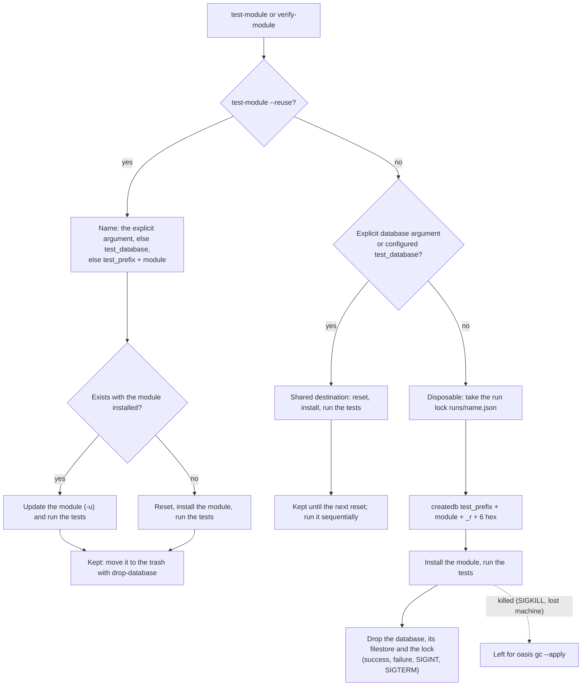

# Tests and test databases

`test-module` and `verify-module` run a module's tests on a test database. Which database a run
uses, and whether it is kept, depends on the arguments and on `[tooling].test_database`:



- [Reusable test destinations and compact evidence](#reusable-test-destinations-and-compact-evidence): a configured or explicit test database.
- [Reusing the test database while iterating](#reusing-the-test-database-while-iterating): `test-module --reuse`.
- [Disposable test databases](disposable-test-databases.md): the default, and `gc` for what interrupted runs leave.

## Reusable test destinations and compact evidence

Keep manual development data in a persistent development database. For sequential automated checks, optionally declare one reusable destination in the project's existing `[tooling]` table:

```toml
# Example only: use the project's actual test namespace.
test_database = 'sample_test_suite'
```

The name must be longer than `test_prefix`, contain only letters/digits/underscores, not end in the reserved run suffix `_r<6 hex>` (optionally `_update`; `test-module` and `verify-module` refuse it), and be at most 56 bytes (reserving `_update` within PostgreSQL's 63-byte identifier limit). Without this setting, each run uses its own disposable database (see [Disposable test databases](disposable-test-databases.md)). In a checkout with a slug the slug is inserted after `test_prefix` (see [Databases per checkout](checkouts-and-worktrees.md#databases-per-checkout)) and the 56 bytes include it. An explicit database argument overrides the test destination; it must still be an approved disposable test database.

After obtaining authorization to reset the exact destinations:

```bash
~/.agents/skills/odoo19/oasis --project /absolute/project test-module --compact your_module
~/.agents/skills/odoo19/oasis --project /absolute/project verify-module --compact your_module
~/.agents/skills/odoo19/oasis --project /absolute/project test-module --compact --only TestOrder.test_total your_module
```

### Running one test class or method

`test-module --only <Class[.method]>` runs the tests of one class of the module, or one method of it, by passing `--test-tags /<module>:<Class>[.<method>]`. The module is still installed in the test database first, so it shortens the test phase, not the install; use it while fixing one test and run the whole module before finishing. Any other value exits 2 with `--only takes a test class or Class.method.` before any effect. A class or method that does not exist is not an error for Odoo: the run ends with exit 0 and `0 failed, 0 error(s) of 0 tests`. Whether the series takes a class filter comes from the capability table (`test_class_filter`); a series without it refuses with `--only is not available for Odoo <series>.`

### Destinations and evidence

| Command | Destinations and evidence |
| --- | --- |
| `test-module` | Resets the configured destination (or the explicit one), installs the module and runs its tests. Without either, it runs on a new disposable database. |
| `verify-module` | Uses that test destination and a separate `<destination>_update` for a fresh install followed by current-code update. With an explicit test destination and a configured one, its `_update` sibling is used; with only an explicit one, `<test_prefix><module>_update`; an explicit third argument overrides it. Without either, both are disposable: the run's database and its `_update` sibling. This does not prove historical migration. |
| `--compact` | Opt-in summaries preserve phase status and stdout/stderr log paths. Full streams remain in unique private directories under project `dev/logs/odoo19/` (with `[tooling].logs`, under `<logs>/<main|slug>/`; see [Preparing a linked worktree](checkouts-and-worktrees.md#preparing-a-linked-worktree)); without it, output remains unchanged. Inspect relevant failing log excerpts, not all successful logs. |

### Ports, temporary directory and browser evidence

The Odoo test process also gets `--http-port=<free port>` and the Odoo series' second port option (`--gevent-port=<free port>` on 19.0, `--longpolling-port=<free port>` on 15.0, the port HttpCase tests use) right after the configuration options: two distinct ports the system hands out as free on 127.0.0.1 just before the run, so `test-module` and the tests phase of `verify-module` (with or without `--compact`) never collide with a running development server, even one with workers. The install and update phases and the rest of the command line are unchanged.

The test command line always ends with `--stop-after-init`: 19.0's `--test-tags` implies it, 15.0's does not (`test_tags_implies_stop` in the capability table), so without it a 15.0 test run would keep serving after its tests. Installing without demo data passes the series' option: `--without-demo` on 19.0, `--without-demo=all` on 15.0 (its option takes a value; alone it would take the next word of the command line).

The Odoo **test process only** receives a fresh private (0700) short `/tmp/odoo19-test-*` directory as `TMPDIR`, independent of inherited nesting. The caller's environment, runtime probes, database guards, install and update invocations are unchanged. After the child exits, browser `chrome_logs` files and screenshots/videos remaining under its `odoo_tests` tree are copied privately (directories 0700, files 0600) into a unique directory under project `dev/logs/odoo19/` (or the `[tooling].logs` directory of the checkout), then only that invocation's scratch is removed. Browser profiles/cookies and evidence symlinks are not collected. No extra normal output is emitted; child stdout/stderr and exit status (including signal-derived status) are preserved, including through `--compact`. Retention or cleanup failure reports the owned scratch path for inspection and returns failure rather than claiming success; failed retention leaves scratch intact. SIGINT/SIGTERM are forwarded to the child before collection; uncatchable termination cannot guarantee collection or cleanup.

This does not change Odoo's skip classification: a successful exit can still include skipped browser tests. Inspect test results and retained diagnostics; the wrapper does not count tests or reinterpret skips. Retained diagnostics can contain application data and require deliberate owner-managed retention; no previous temporary directories or evidence are cleaned automatically.

### Sequential runs and consent

Both commands support `--help`. Ensure `dev/logs/` (or a `[tooling].logs` directory inside the checkout) is ignored by project version control. Logs can contain application data; do not publish them or collect credentials. Run shared destinations (an explicit or configured database) **sequentially**: there is no execution scheduler or lock for them. Existing active sessions block reset, but that check is not a concurrency lock. Disposable databases are private to their run, so default runs may run in parallel. Use explicitly approved separate targets for retained baseline scenarios; do not invent explicit database names for every edit. Preserve failed-run evidence until investigation is complete: a disposable database is dropped at the end of its run, and a later reset overwrites a shared destination, even though prior logs remain.

The setting is **not reset consent** and does not create a database when read. Never reset the manual development database, infer approval from the namespace, or terminate sessions of a shared destination automatically; only a run's own disposable databases and `gc --apply` close sessions and drop databases. Existing databases are left untouched by installing this change. Template or workspace file changes require the normal authorization.

## Reusing the test database while iterating

```bash
~/.agents/skills/odoo19/oasis --project /absolute/project test-module --compact --reuse --only TestOrder.test_total your_module
```

Installing a module in a new database usually takes far longer than its tests. `test-module --reuse` keeps a working test database between runs:

- Name: the explicit `test_database` argument, else `tooling.test_database`, else `<test_prefix><module>` (`<test_prefix><slug>_<module>` in a checkout with a slug). The same name rules apply as for any explicit test database.
- When the database exists and the module is installed in it, the run updates the module (`-u <module>`) and runs the tests. Otherwise the database is reset and the module installed, exactly as without `--reuse`.
- Nothing is dropped at the end, and `gc` does not touch it: move it to the [trash](trash.md) with `drop-database` when you are done. Run reuse targets sequentially.
- With `--compact`, the line after `phase=tests ...` is `database_lifecycle=reused mode=<install|update>`.
- A reused database carries whatever earlier runs left in it and only the tested module is updated. Use it while fixing a test, and run once without `--reuse` (a fresh database) before reporting a result.
